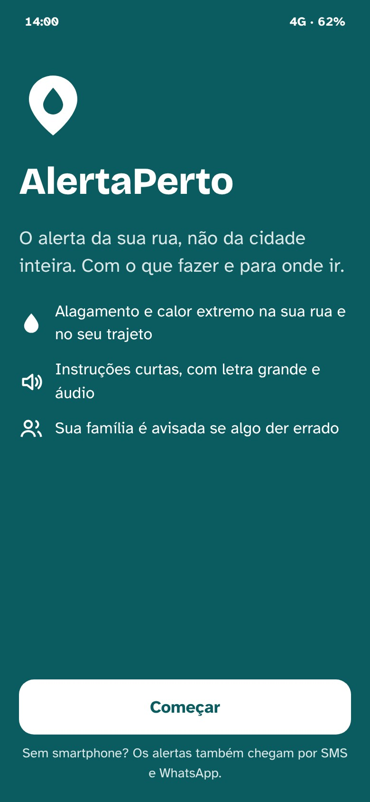
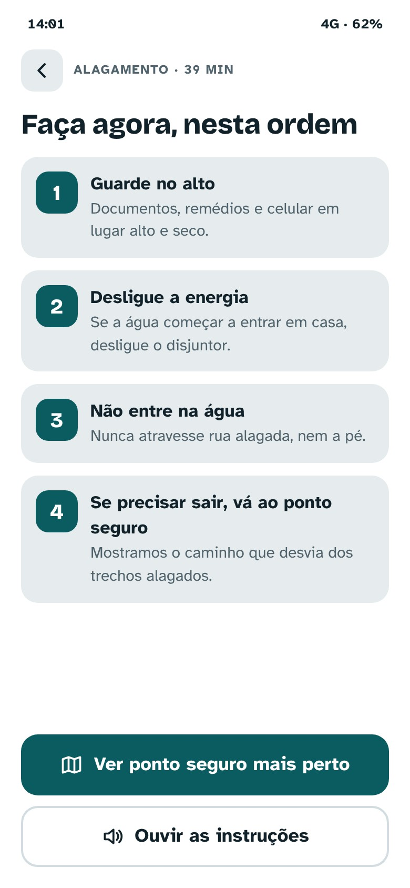
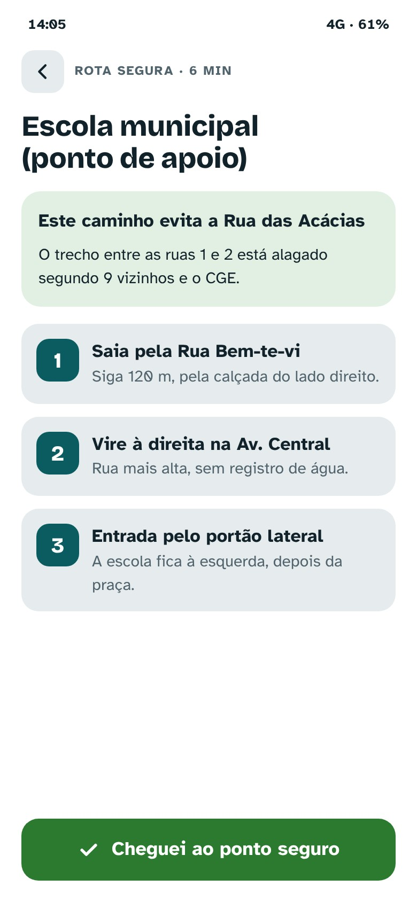
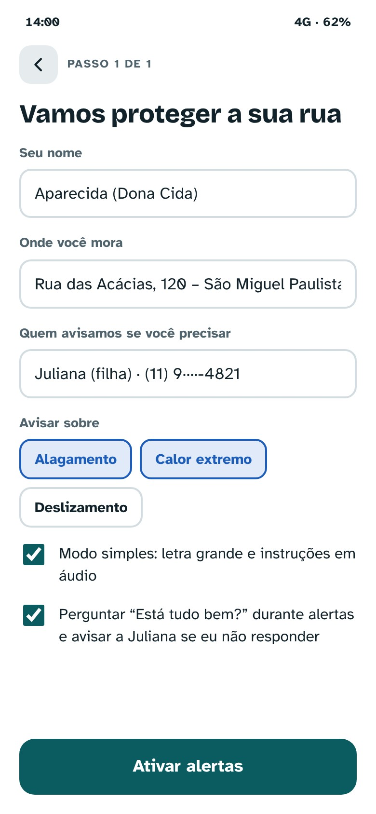
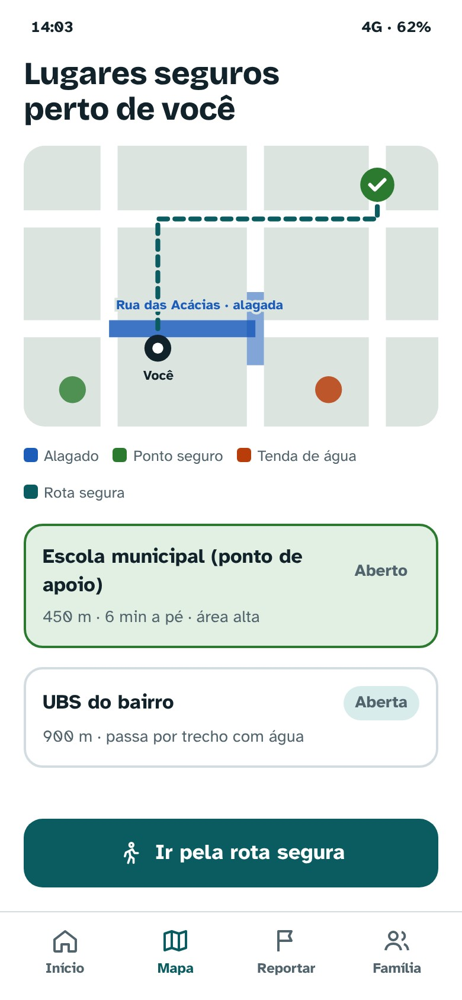
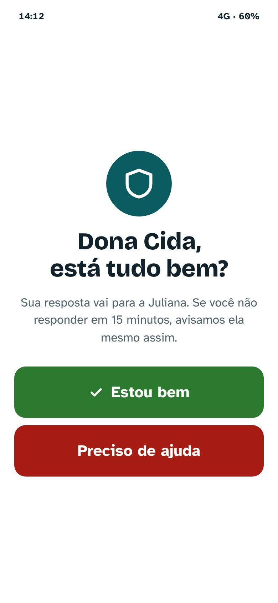
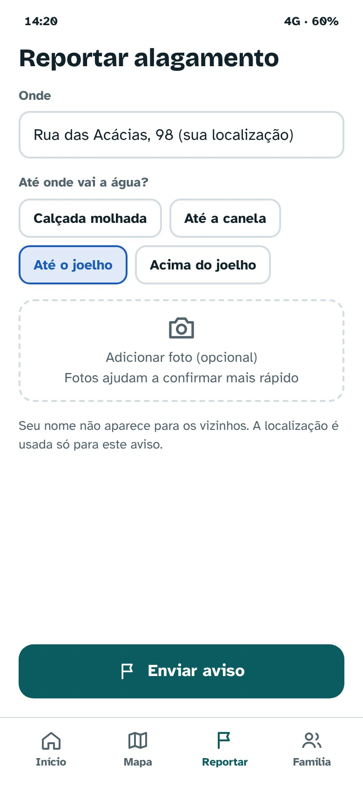
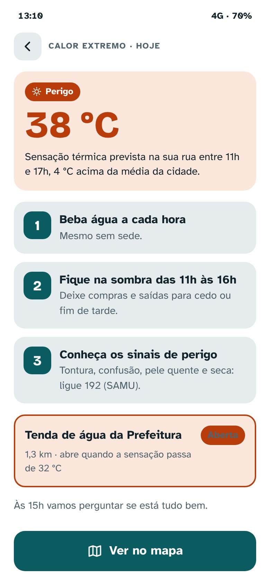
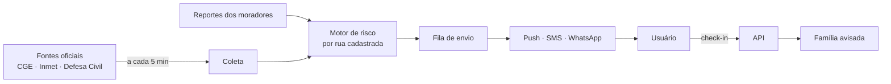

# 📍 AlertaPerto

### O alerta da sua rua, com o que fazer e para onde ir.

**Solução para o desafio CitizenTech da Global Solution FIAP: alertas hiperlocais de alagamento e calor extremo em São Paulo, com instruções, rota segura e aviso automático à família.**

    

[▶️ Abrir o protótipo navegável no Figma](https://www.figma.com/proto/t40gDyUWm5b20plWRF7EuE/Global-Solution-AlertaPerto) · [📄 Apresentação (PDF)](docs/apresentacao-alertaperto.pdf) · [🎬 Pitch em vídeo](docs/pitch-alertaperto.mp4)

---

## 🌧️ O problema

Os alertas atuais avisam **a cidade inteira**, muitas vezes tarde, e **não dizem o que fazer**.

- **32** pontos de alagamento ativos ao mesmo tempo em SP no temporal de 24/01/2025 (CGE)
- **37,2 °C**, a maior máxima já registrada em um dia de dezembro na capital (Inmet, 28/12/2025)
- **674 mil** pessoas vivem em áreas de risco na cidade de São Paulo, 8,5% delas idosas (IBGE/Cemaden)
- Até **8 °C** de diferença entre Paraisópolis e o Morumbi, a 800 m de distância: a temperatura oficial não representa a sua rua

**Persona:** Dona Cida, 68 anos, mora em São Miguel Paulista numa rua que alaga e usa um celular simples. A filha, Juliana, trabalha no centro e fica sem notícias quando chove forte.

## 💡 A solução

| Recurso | Como funciona |
|---|---|
| **Alerta por rua e trajeto** | Alagamento e calor para a casa, o trabalho e o endereço de quem você cuida |
| **O que fazer agora** | Passos curtos, na ordem certa, com letra grande e áudio |
| **Lugares seguros e rota** | Pontos de apoio, UBS e tendas de água no mapa, com caminho que desvia da água |
| **Reporte dos vizinhos** | Moradores confirmam alagamentos com foto; o dado também vai para o CGE |
| **Rede de cuidado** | Check-in "Está tudo bem?" e aviso automático à família se não houver resposta |
| **Pouca internet? Funciona** | Modo leve e alertas por SMS e WhatsApp para quem tem celular simples |

## 📱 Protótipo — 13 telas

     

Jornada principal: **Começar → Ativar alertas → Ver alerta → O que fazer agora → Ponto seguro → Rota segura → Cheguei → Estou bem (família avisada)**.

## 🏗️ Arquitetura proposta

## 🎯 Impacto e ODS

- **ODS 11.5** — menos pessoas afetadas por desastres, com foco nos vulneráveis
- **ODS 13.1** — mais resiliência e adaptação a chuvas e ondas de calor
- **ODS 3.d** — saúde e bem-estar

Métricas propostas: usuários avisados antes de a água chegar, tempo até o "Estou bem", atendimentos por calor entre idosos cadastrados e reportes confirmados enviados ao CGE.

> Endereços, horários e locais do protótipo são ilustrativos.

---

## 👤 Autor

**Christian Santos** — Estudante de Análise e Desenvolvimento de Sistemas na FIAP · Desenvolvedor Back-end & Mobile

